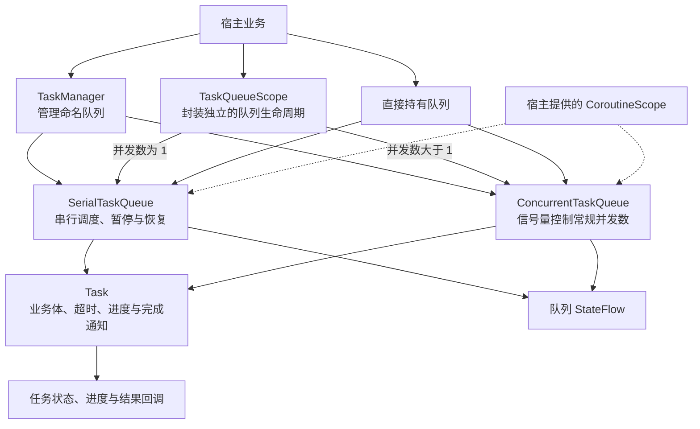
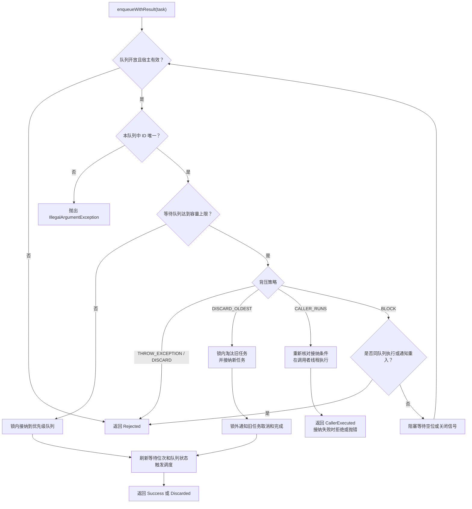
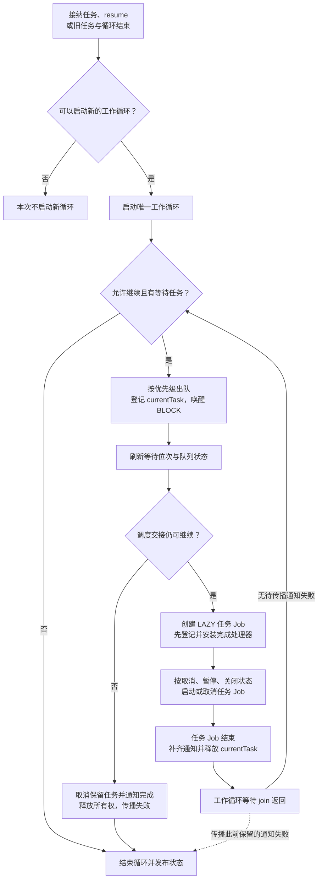
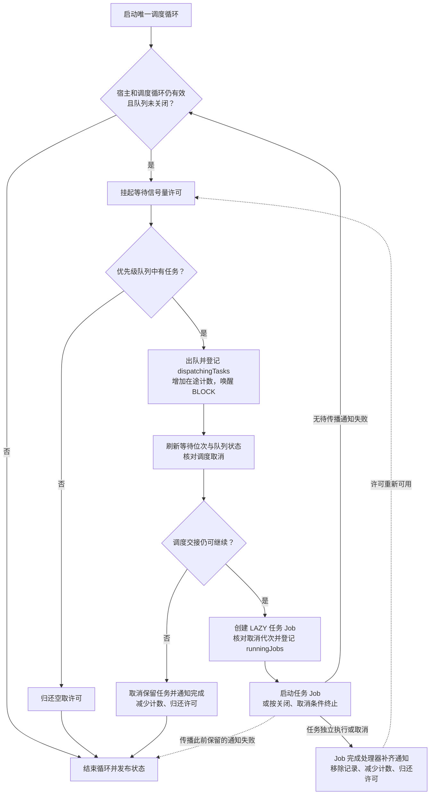
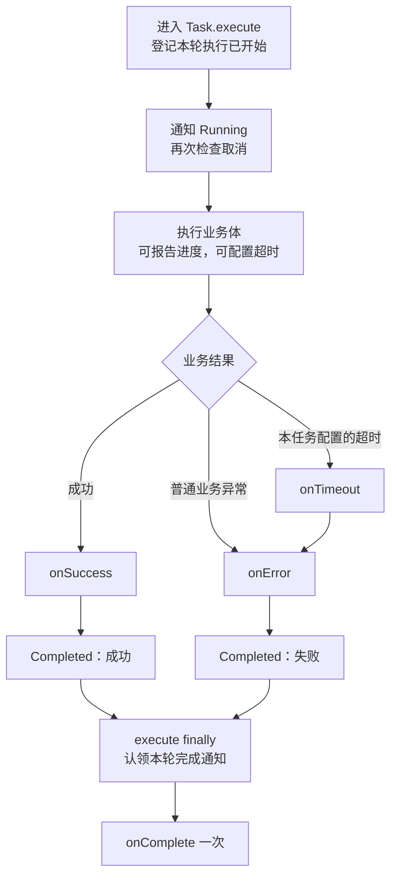
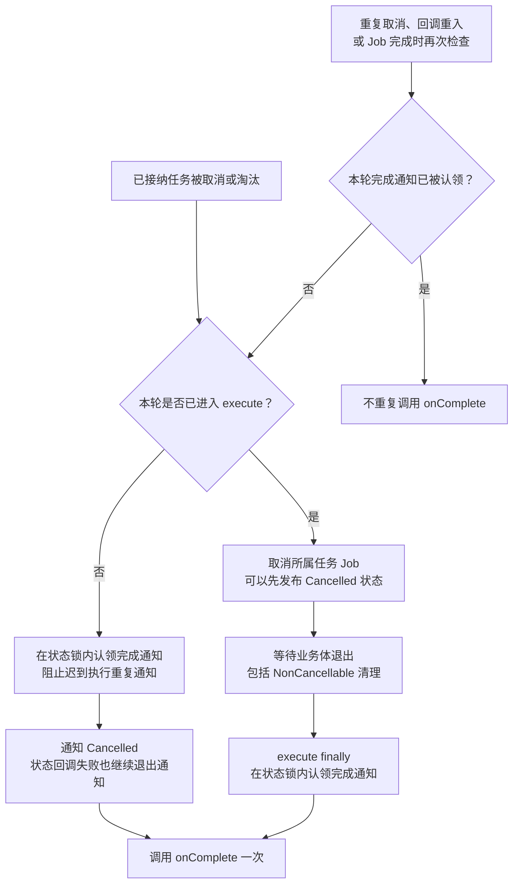

# 架构与业务流程

本文说明任务从提交、调度到结束通知的完整路径。图中的串行与并发调度均指等待队列中的常规任务；`CALLER_RUNS` 另走调用者执行路径。

[返回项目说明](../README.md)

## 总体架构

三种入口最终使用同一套队列实现。`TaskManager` 需要先调用 `initialize(scope)`；指定名称不存在时，提交会回退到对应的默认队列。`TaskQueueScope` 根据 `maxConcurrency` 选择底层队列，不另外创建根作用域。

队列负责自身任务和调度循环的生命周期，`cancelAll()`、`shutdown()` 不会主动取消宿主共享的 `CoroutineScope`。反向关系则不同：宿主作用域的 Job 结束或开始取消时，队列会关闭并唤醒阻塞生产者。

内部协作按职责分为三部分：`QueueExecutionContext` 标记任务执行与同步通知，防止满容量时重入同一队列造成 BLOCK 等待；`QueueStateFlow` 按版本发布状态，避免旧快照覆盖新快照；`QueueLifecycle` 统一取消通知、关闭拒绝与失败聚合。

## 接纳任务与背压

容量仅统计等待任务，不含执行中任务。构造器默认无界；启用背压后，淘汰顺序是优先级最低者先，同优先级取最早入队者。普通出队顺序则相反：优先级高者先，同优先级按入队序号保持 FIFO。

图中合并了锁内决策和锁外通知：淘汰旧任务、接纳新任务的集合变更在同一次持锁操作中完成，随后才通知旧任务取消、刷新位次并启动调度。外部回调不在队列锁内执行；已接纳任务不会仅因入队通知失败而失去调度机会。

`enqueueWithResult` 用返回值区分接纳、淘汰、就地执行和拒绝。便捷 `enqueue` 在关闭时抛 `TaskQueueClosedException`，在 THROW_EXCEPTION 或满容量 BLOCK 重入拒绝时抛 `TaskQueueFullException`。未接纳任务不触发 `onComplete`；同 ID 冲突直接抛异常，不属于背压拒绝。

`CALLER_RUNS` 会阻塞调用者，可能使总在途数超过 `maxConcurrency`，也不受串行队列的 `pause()` 控制。`BLOCK` 是线程阻塞，不能用于主线程，也不能占住队列推进所需的调度线程。

## 串行调度

开始新循环前同时检查暂停、关闭、宿主有效性、旧工作循环和在途任务。常规任务未完成清理前，不会启动替代任务。任务与工作循环分别在完成时尝试恢复调度，处理二者取消后以不同顺序退出的情况。

`pause()` 取消当前工作循环所持有的任务，并阻止继续出队；等待中的任务保留，`resume()` 后继续。串行 `cancel(id)` 只命中等待中或已出队但尚未登记执行 Job 的任务，不能取消已交接执行的任务。需要取消所有现存任务时使用 `cancelAll()`。

图中的“交接不可继续”包括调度协程已经取消或通知抛出致命错误。可继续派发的普通通知失败会先保留，等本次任务退出后再传播，当前工作循环随之结束；完成处理器仍会按暂停、关闭及宿主状态决定是否恢复调度。

## 并发调度

并发队列先获得许可，再从优先级队列取任务，因此等待任务的出队顺序由优先级决定。多任务交给 dispatcher 后，业务体的实际开始、完成顺序不保证 FIFO。

任务从出队起就计入在途任务：先由 `dispatchingTasks` 保存交接记录，再交给 `runningJobs`。`cancelAll()` 推进取消代次，使尚未完成交接的旧任务不能绕过取消。Job 完成处理器负责归还许可，包括任务协程从未进入业务体就被取消的情况。

调度协程取消或交接通知的致命错误会终止当前调度循环；可继续派发的普通通知失败则在本次任务启动后传播，同样结束当前循环。若宿主仍有效、队列未关闭且仍有等待任务，循环完成处理器会尝试重新启动调度。任务业务体独立执行，不由调度循环逐个等待。

`runningTaskCount` 包括交接中的任务、取消后仍在清理的任务以及 CALLER_RUNS 任务。`awaitCompletion()` 等待实际空闲条件，而不是只看到某个展示状态；它不会停止接纳新任务。需要关闭后等待清理时，先调用 `shutdown()`，再从仍有效的协程调用挂起版 `awaitCompletion()`。

## 任务结果与完成通知

成功和普通业务失败按下图通知。任务自己配置的超时转为业务失败；宿主取消或业务内部抛出的取消异常走下一节的取消路径。

进度回调只在本轮业务体仍接收进度且协程有效时生效。回调没有自动切换主线程：等待状态通知在提交或调度线程执行，进度通知在报告线程执行，执行结果通知在任务执行上下文执行。

普通任务回调异常会被日志隔离。取消异常与致命错误继续传播，因此上图的后续成功/失败通知可能被中断，但仍会尝试执行 `onComplete`。多个退出失败按“致命错误优先，同等级保留首个错误”聚合，其余错误作为附加异常保存。

## 取消时如何保证每轮完成通知一次

每次接纳创建独立的 `CompletionAttempt`。执行开始与执行前取消在同一状态锁内决定由谁通知完成，并在调用外部回调前记录完成通知已被认领；因此 `onStateChange` 或 `onComplete` 中再次取消队列，不会重复发出同一轮完成通知。

未开始执行的任务可以由队列取消路径直接完成通知；已经开始执行的任务则由 `execute` 的 `finally` 负责。LAZY Job 未进入协程体就被取消时，Job 完成处理器补齐通知。取消状态不等于清理完成，也不等于队列已经空闲。

| 操作或场景 | 完成通知与作用域边界 |
| --- | --- |
| `Task.cancel()` | 只设置取消标记，不直接中断运行中的业务体，也不直接触发 `onComplete` |
| 待执行任务取消或淘汰 | 已接纳任务收到取消状态及一次完成通知 |
| 执行中取消 | 等本轮业务体清理退出后通知完成；不合作的业务体可能延迟结束 |
| `cancelAll()` | 取消调用时截取的旧任务集合，队列仍可接纳新任务；不取消宿主共享作用域 |
| `shutdown()` | 永久停止接纳、唤醒 BLOCK、取消自身调度与任务；本方法不阻塞等待清理 |
| 串行 `clear()` | 静默移除等待任务，保留 Pending 状态，不通知取消或完成 |
| 容量拒绝、关闭拒绝 | 任务没有被接纳，不触发 `onComplete` |
| 同一 Task 实例再次提交 | 必须等上一轮执行及回调全部退出；不能同时跨队列使用，取消标记不会自动清除 |

## 队列状态与源码索引

| 队列 | 可观察状态 |
| --- | --- |
| 串行队列 | `Idle`、`Waiting`、`Running`、`Paused`、`Full`、`Closing`、`Shutdown` |
| 并发队列 | `Idle`、`Running`、`Full`、`Closing`、`Shutdown` |

串行 `Full` 是溢出时的瞬时提示，且不覆盖 `Paused`；并发 `Full` 由当前等待容量计算。两种队列关闭后，只要仍持有任务或调度循环，就保持 `Closing`，完全退出后才是 `Shutdown`。`isClosed` 表示不再接纳，`isTerminated` 表示关闭且自身工作已全部退出。

`StateFlow` 会合并中间值，不能把它当作每次状态变化都必达的事件日志。任务状态回调也可能因跨线程通知而与当前快照短暂不同；判断队列是否排空，应使用队列的查询或等待接口。

| 职责 | 实现 |
| --- | --- |
| 命名队列管理与默认队列回退 | [TaskManager.kt](../src/main/kotlin/com/cn/tasks/TaskManager.kt) |
| 按并发数选择队列，转发生命周期操作 | [TaskQueueScope.kt](../src/main/kotlin/com/cn/tasks/TaskQueueScope.kt) |
| 串行接纳、暂停、交接与工作循环 | [SerialTaskQueue.kt](../src/main/kotlin/com/cn/tasks/SerialTaskQueue.kt) |
| 并发接纳、信号量、取消代次与 Job 交接 | [ConcurrentTaskQueue.kt](../src/main/kotlin/com/cn/tasks/ConcurrentTaskQueue.kt) |
| 每轮执行、超时、进度及完成通知 | [Task.kt](../src/main/kotlin/com/cn/tasks/Task.kt) |
| 背压配置与接纳结果 | [BackpressureConfig.kt](../src/main/kotlin/com/cn/tasks/BackpressureConfig.kt)、[EnqueueResult.kt](../src/main/kotlin/com/cn/tasks/EnqueueResult.kt) |
| 重入保护、状态发布与生命周期协作 | [QueueExecutionContext.kt](../src/main/kotlin/com/cn/tasks/QueueExecutionContext.kt)、[QueueStateFlow.kt](../src/main/kotlin/com/cn/tasks/QueueStateFlow.kt)、[QueueLifecycle.kt](../src/main/kotlin/com/cn/tasks/QueueLifecycle.kt) |
